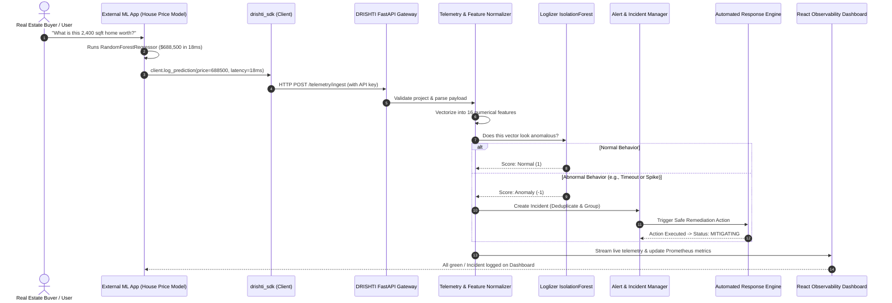

# 🔭 DRISHTI AI — The Ultimate Explainer & Architectural Guide
*Intelligent MLOps & AIOps Platform — Explained so clearly that even a 5th grader can master it!*

---

> [!NOTE]
> **What does "DRISHTI" mean?**  
> In Sanskrit, **Drishti (दृष्टि)** means **"Vision"**, **"Sight"**, or **"Deep Insight"**.  
> Just like a telescope gives astronomers vision into the deepest parts of space, **DRISHTI AI** gives software engineers complete 20/20 vision into the hidden inner workings, health, and brains of their Machine Learning models.

---

## 🌟 Act I: The 5th-Grade Story — Why Does AI Need a Guardian?

Imagine you build a super-smart robot dog named **Robo-Buddy** to guard your house. 

When you first bring Robo-Buddy home from the toy store, he is amazing! He knows who your family is, he catches frisbees, and he barks whenever a burglar tries to sneak into the backyard.

```
       [Your Smart Robot Dog: Robo-Buddy]
         /              |              \
   [Catches Frisbees] [Barks at Burglars] [Loves Family]
```

### But then... strange things start happening:

1. **He gets tired and slow:** One day, Robo-Buddy takes 10 whole minutes just to stand up and bark when someone rings the doorbell.
2. **He gets confused (Brain Drift):** In the winter, snow falls. Robo-Buddy has never seen snow before. He thinks the snowman in the yard is a giant monster and starts howling all night!
3. **His battery overheats (Resource Crunch):** His gears get jammed, his motor gets scorching hot, but he doesn't tell anyone—he just freezes mid-walk.
4. **He makes silent mistakes:** When a mail carrier delivers a package, Robo-Buddy politely bows to the burglar and barks at grandma!

In normal software (like a calculator), if something breaks, the calculator just crashes with a big red error message: **"ERROR 404"** or **"DIVISION BY ZERO"**. You know right away it is broken.

**Machine Learning models are different.** When an AI breaks, it **does not crash**. Instead, it gives you a **completely wrong answer with total confidence!** A medical AI might misread an X-ray, or a self-driving car AI might mistake a stop sign for a speed limit sign, without ever throwing a computer crash code.

### Enter DRISHTI AI 🛡️
**DRISHTI AI is the smart Doctor, the Fitness Tracker, and the 24/7 Security Guard for Robo-Buddy.**

* It straps a smartwatch onto Robo-Buddy to measure his heart rate, temperature, and speed (**Telemetry & Prometheus Metrics**).
* It listens to every noise and bark he makes (**Log Processing & Feature Extraction**).
* If he barks strangely or stumbles, a detective AI spots the weird pattern before anything bad happens (**Loglizer IsolationForest Anomaly Detection**).
* If Robo-Buddy gets sick, DRISHTI AI doesn't wake you up 500 times with annoying alarms; it groups the problems into one tidy report (**Keep Incident Management**).
* It immediately sends a mini first-aid robot to cool down his battery or reset his gears safely (**Automated Remediation Engine**).
* It checks if Robo-Buddy's memory is fading over time (**Ground-Truth Drift & Accuracy Tracking**).
* It gives you a giant, glowing NASA-style command screen in your bedroom so you can see how Robo-Buddy is doing at a glance (**The Live React Dashboard**).

---

## 🎯 Act II: The 3 Big Questions (The Why, What, and How)

### 1. WHY are we doing this? (The Real-World Problem)

| Without DRISHTI AI ❌ | With DRISHTI AI ✅ |
| :--- | :--- |
| **Silent Failures:** An AI gives wrong predictions for weeks before anyone notices. | **Instant Drift Detection:** Every prediction is verified against reality; accuracy drift is caught immediately. |
| **Alert Fatigue:** A database hiccup sends 2,000 angry email alerts at 3 AM to engineers. | **Smart Deduplication:** 2,000 log errors are fingerprinted and grouped into **1 neat incident**. |
| **Mysterious Slowness:** An AI server slows to a crawl, and engineers have to read millions of lines of text logs to find why. | **16-Feature Anomaly Brain:** Machine Learning scans the logs in milliseconds and highlights the exact problem. |
| **Manual Firefighting:** A human engineer has to wake up in the middle of the night to restart a crashed cache. | **Automated First Aid:** Safe remediation playbooks run automatically to stabilize systems. |
| **One-Off Custom Code:** Every time a company builds a new AI, they have to rewrite monitoring from scratch. | **Universal SDK:** Any Python developer connects any AI to DRISHTI in **5 lines of code**. |

---

### 2. WHAT are we actually doing?

DRISHTI AI merges two of the most exciting fields in modern computer science into a single, unified system:

1. **MLOps (Machine Learning Operations):**
   * *The Lab & Factory:* How we prepare training data, train machine learning algorithms, compare their scores, test them in experiments, and safely release them into the world.
2. **AIOps (Artificial Intelligence for IT Operations):**
   * *The Guardian & Doctor:* Using Machine Learning itself to watch over software, scan server logs, detect anomalies, sound the alarm, and heal computer systems automatically.

```
+-----------------------------------------------------------------------------------+
|                                DRISHTI AI PLATFORM                                 |
+-----------------------------------------------------------------------------------+
|               MLOps ENGINE               |               AIOps ENGINE             |
|  - Dataset Preparation                  |  - Universal Telemetry Ingestion       |
|  - Model Training (Scikit-Learn/PyTorch)|  - 16-Dimensional Log Normalization    |
|  - MLflow Experiment Tracking           |  - Loglizer IsolationForest Detection  |
|  - Model Registry & Stage Promotion     |  - Multi-Project Incident Deduplication|
|  - Live Model Serving Endpoint          |  - Safe Automated Playbook Remediation |
|  - Ground-Truth Accuracy Drift Tracking |  - Prometheus Time-Series Metrics      |
+-----------------------------------------------------------------------------------+
|                                  USER EXPERIENCE                                  |
|         Universal Python SDK (`drishti_sdk`)  +  Dark-Mode SPA Dashboard          |
+-----------------------------------------------------------------------------------+
```

---

### 3. HOW are we doing this? (The Step-by-Step Data Journey)

Every time an external AI makes a prediction (for example, predicting the price of a house or classifying a photo), it travels through an 8-stage assembly line:



---

## 🧰 Act III: The Resources & Technologies — What We Used and WHY

Every single tool and library in DRISHTI AI was chosen for a specific architectural reason. Here is the full breakdown:

| Technology | What it is | 5th-Grade Metaphor | Why We Chose It (Engineering Reason) |
| :--- | :--- | :--- | :--- |
| **Python 3.13** | The programming language | *The master toolbox* | Python is the uncontested global standard for AI, Machine Learning, and data science. All ML models, math libraries, and backend frameworks run natively here. |
| **FastAPI** | High-performance Web Framework | *The supersonic bullet train* | Built on modern `asyncio`. Up to 300% faster than Flask or Django. Generates automatic Swagger/OpenAPI documentation, performs strict type validation with Pydantic, and handles high concurrency telemetry streams without slowing down. |
| **Uvicorn** | ASGI Web Server | *The supercharged engine* | Blazing-fast lightning server that powers FastAPI. It handles incoming web requests concurrently on Windows, Linux, and macOS. |
| **Loglizer** | Log Anomaly Detection Toolkit | *The forensic detective* | Created by AI researchers at CUHK. Provides proven, production-grade unsupervised machine learning algorithms specifically tuned to analyze log sequences without needing millions of human labels. |
| **Isolation Forest (iForest)** | Machine Learning Algorithm | *The oddball spotter* | Explain like you're 5: Imagine a crowd of 100 people wearing white shirts, and one person wearing a glowing neon-pink dinosaur suit. If you play a guessing game by asking random questions ("Are you wearing pink?"), you isolate the dinosaur person in just **1 question**, while normal people take 10 questions to isolate! **Isolation Forest builds random decision trees; weird events get isolated near the top of the tree quickly!** Perfect for unsupervised anomaly detection. |
| **MLflow** | Experiment Tracking Platform | *The digital scientist's lab notebook* | When training models, scientists try 50 different formulas. MLflow automatically records the hyperparameters, accuracy scores, loss curves, and artifact files for every single run, allowing 1-click model rollback. |
| **Prometheus Metrics Engine** | Systems Monitoring Standard | *The hospital vital-signs monitor* | Instead of printing messy text files, Prometheus records structured time-series counters and histograms (`requests_total`, `latency_seconds`, `anomalies_total`). It is the industry-standard monitoring protocol used by Google, Netflix, and Kubernetes. |
| **Keep Incident Management** | Open-source AIOps Orchestrator | *The 911 dispatch center* | Connects to Slack, PagerDuty, and email. Provides smart alert deduplication so one server hiccup doesn't blast an engineer with 500 duplicate texts. (Backed by DRISHTI's local zero-dependency incident engine). |
| **React 18 & Tailwind CSS** | Frontend Dashboard | *The NASA space shuttle cockpit* | Zero-build, single-page application loaded directly from the backend. Modern dark-themed UI with glassmorphism cards, responsive KPI grids, and real-time polling without requiring a heavy Node.js compile step. |
| **drishti_sdk** | Lightweight Python Client | *The universal walkie-talkie* | A zero-friction Python library that developers can import anywhere. It abstracts away HTTP calls, batching, threading, and authentication into simple one-liners like `client.log_prediction()`. |
| **Joblib & Scikit-Learn** | Model serialization & algorithms | *The deep freezer for AI brains* | Allows complex trained machine learning models (like our 100-tree Isolation Forest) to be frozen to a compact binary file (`.joblib`) on disk and reloaded in 5 milliseconds into memory. |

---

## 🔍 Act IV: Component Deep Dive (The 8 Engines of DRISHTI AI)

Let's look under the hood of each major module inside `C:\Users\PRIYANSHU\Desktop\DRISHTI-AI`.

### 1. The Universal Python SDK (`drishti_sdk/client.py`)
* **What it does:** Allows ANY third-party Python application—whether it's predicting house prices, detecting credit card fraud, or running a large language model—to connect to DRISHTI AI.
* **How it works:**
  * Runs a background thread buffer (`batch_size=10`).
  * If the network is slow, it buffers telemetry so the main AI application never slows down or freezes.
  * Masks API keys so credentials never leak in logs.
* **Code Example (How a developer uses it in 5 lines):**
  ```python
  from drishti_sdk import DrishtiClient

  # 1. Connect the walkie-talkie
  client = DrishtiClient(
      project_id="house-price-prediction",
      api_key="dr_live_e94e7732a...",
      endpoint="http://127.0.0.1:8000"
  )

  # 2. Log a prediction in real-time
  client.log_prediction(
      model_name="random-forest-v1",
      inputs={"sqft": 2400, "bedrooms": 4},
      prediction=688500.0,
      latency_ms=18.5,
      ground_truth=690000.0  # Optional: when verified sale price arrives
  )
  ```

---

### 2. Multi-Tenant Project Manager (`integration/project_manager.py`)
* **What it does:** Ensures complete security and data isolation. Project A (e.g., Medical Records AI) can never see or contaminate data from Project B (e.g., House Price AI).
* **How it works:**
  * Generates cryptographically secure API keys prefixed with `dr_live_...`.
  * Stores only SHA-256 hashes of the keys in `data/projects.json`.
  * Isolates every project's logs into its own dedicated file: `data/telemetry/{project_id}.jsonl`.

---

### 3. Adaptive 16-Dimensional Normalization (`integration/telemetry_service.py`)
* **The Problem:** Different AI apps send totally different logs. A database logs `"Connection timed out"`, while an NLP model logs `"Out of memory"`. How can one Machine Learning model understand all of them?
* **The Solution:** DRISHTI AI translates any raw message into a standardized **16-dimensional numeric feature vector**:
  ```
  Feature 1..4:   [Is_INFO, Is_WARNING, Is_ERROR, Is_CRITICAL]
  Feature 5..13:  [Database, Prediction, Memory, Inference, Latency, Auth, Model, API, Other]
  Feature 14..16: [Is_Timeout_Flag, Is_Failed_Flag, Is_High_Resource_Flag]
  ```
* Every log becomes a mathematical point in 16D space that Loglizer can analyze instantly!

---

### 4. Loglizer Isolation Forest Detector (`integration/train_anomaly_detector.py`)
* **What it does:** Evaluates the 16-feature vector against an unsupervised ensemble of 100 decision trees.
* **Parameters:**
  * `contamination=0.20`: Expects roughly 20% of anomalous edge cases during training.
  * `n_estimators=100`: 100 randomized trees casting votes.
* **Output:**
  * `+1 (NORMAL)`: Normal event. Logged quietly.
  * `-1 (ANOMALY)`: Odd event! Immediately triggers the Incident Management System.

---

### 5. Smart Incident Management & Deduplication (`integration/alert_manager.py`)
* **The Problem:** When an outage happens, 1,000 log errors occur in 10 seconds. An engineer doesn't want 1,000 text messages!
* **The Solution:** 
  * DRISHTI AI calculates an MD5 fingerprint based on: `hash(project_id + severity + category + error_type)`.
  * If 50 errors with the same fingerprint arrive within a window, DRISHTI AI does **not** create 50 incidents. It keeps **1 single incident** and increments `occurrences: 50`.
  * Maintains an audit lifecycle: `OPEN` ➡️ `INVESTIGATING` ➡️ `MITIGATING` ➡️ `RESOLVED` ➡️ `CLOSED`.

---

### 6. Safe Automated Remediation Engine (`integration/response_engine.py`)
* **What it does:** The emergency first-responder robot.
* **Safety First:** It never executes destructive terminal commands (like `rm -rf` or killing real servers).
* **Playbooks:**
  * *Database Timeout:* Executes connection pool recycling, invalid query purging, and read-replica switchover simulations.
  * *High Memory Spike:* Triggers cache clearing and garbage collection simulations.
  * *API Latency Spike:* Triggers rate-limiting and circuit breaker simulations.
* Every remediation is logged in `alerts/remediation_audit.json` with an exact timestamp and actor tag.

---

### 7. Ground-Truth Accuracy & Drift Tracker (`integration/telemetry_service.py`)
* **What it does:** Measures if the AI model is losing its mind over time.
* **How it calculates it:** When ground truth arrives, it calculates:
  $$\text{MAE} = \frac{1}{n} \sum_{i=1}^n |y_{\text{pred}} - y_{\text{actual}}|$$
  $$\text{RMSE} = \sqrt{\frac{1}{n} \sum_{i=1}^n (y_{\text{pred}} - y_{\text{actual}})^2}$$
* If RMSE drifts past a healthy threshold, DRISHTI flags the model as `POTENTIAL_DRIFT`, signaling that the model needs to be retrained!

---

### 8. The Flight Deck Dashboard (`integration/dashboard_html.py`)
* **What it does:** Serves a single-page reactive command center at `http://localhost:8000/dashboard`.
* **Features:**
  * **Active Workspace Selector:** Instantly switches context between projects (`House Price Valuation Engine`, `NYC Taxi Demo`, or `All Projects`).
  * **Live Telemetry Stream:** Real-time table of predictions, latencies, and ground-truth values.
  * **Drift & Accuracy Cards:** Displays real-time MAE, RMSE, and sample sizes.
  * **Interactive Incident Queue:** Review alerts, inspect root causes, and click **Resolve** with one tap.
  * **Prometheus Health & Automated Remediation History:** Full observability at a glance.

---

## 📖 Act V: A Real-Life Walkthrough — "The Story of the House Price Model"

Let's see what happens step-by-step during a live run of our demo application:

```
[Real Estate User] ➡️ [House Price Model] ➡️ [DRISHTI AI Guardian]
```

### 1. The Normal Valuation (Everything is Green 🟢)
1. A real estate agent enters a home: **2,400 sqft, 4 bedrooms, 3 bathrooms**.
2. The `HousePriceModel` calculates an estimated price of **$688,500.00** in **18.5 ms**.
3. `drishti_sdk` sends this prediction to DRISHTI AI.
4. DRISHTI extracts the 16 features. Loglizer evaluates the vector: **NORMAL**.
5. Prometheus increments `drishti_predictions_total` by 1.
6. The event appears on the **Project Telemetry** tab on the Dashboard.

### 2. The Verification (Ground Truth Arrives 🎯)
1. Three weeks later, the home actually sells for **$690,000.00**.
2. The external system reports the actual sale price back to DRISHTI AI.
3. DRISHTI compares:
   * Predicted: `$688,500.00`
   * Actual: `$690,000.00`
   * Error: Just `$1,500.00`!
4. DRISHTI AI computes the overall project MAE (`$3,700.00`) and RMSE (`$3,891.57`).
5. The **Overview Dashboard** updates: Status is **HEALTHY**.

### 3. The Emergency (Database Timeout Spike 🔴)
1. Suddenly, the property tax assessment database hangs.
2. The external app catches a `FeatureStoreTimeoutError` and latency shoots up to **3,200 ms**!
3. The SDK sends the error event to DRISHTI AI.
4. Loglizer flags feature #14 (`is_timeout = 1`): **ANOMALY DETECTED!**
5. Incident Manager immediately registers incident **#1a14cdf6** (`SEVERITY: ERROR`).
6. The Automated Response Engine executes the `database_timeout` playbook, recycling the connection pool.
7. The Incident status updates to **MITIGATING**.
8. The human engineer opens the Dashboard, sees the automated playbook already resolved the pressure, reviews the audit trail, and doesn't have to stress!

---

## 🚀 Act VI: Quickstart & Verification Playbook

Want to experience DRISHTI AI live? Follow these simple steps:

### 1. Start the DRISHTI AI Platform
Open your terminal (PowerShell) in the project directory:
```powershell
.\.venv\Scripts\uvicorn.exe integration.api:app --host 127.0.0.1 --port 8000 --reload
```

### 2. Open the Mission Control Dashboard
Open your browser and navigate to:
```
http://127.0.0.1:8000/dashboard
```

### 3. Seed or Stream Live Data
In a second terminal, seed the House Price Valuation Engine data:
```powershell
.\.venv\Scripts\python.exe scripts\seed_demo_data.py
```
*(Or run the standalone client application: `.\.venv\Scripts\python.exe examples\house_price_service.py`)*

### 4. Switch Projects & Observe
1. In the Dashboard sidebar under **ACTIVE WORKSPACE**, select:  
   **`📁 House Price Valuation Engine (house-price-prediction)`**
2. Click **`📡 Project Telemetry`** to watch the predictions and ground-truth values.
3. Click **`📊 Overview Dashboard`** to view the MAE & RMSE accuracy drift card.
4. Click **`🚨 Incident Management`** to inspect the `FeatureStoreTimeoutError` incident and click **Resolve**.
5. Check Prometheus metrics at: `http://127.0.0.1:8000/metrics`

### 5. Run the Full Test Suite
To verify that all 5 subsystem test suites pass with 100% confidence:
```powershell
.\.venv\Scripts\python.exe scripts\run_all_tests.py
```

---

## 🏆 Summary Checklist: What Makes DRISHTI AI Special?

* [x] **Universal:** Integrates with any ML framework (Scikit-Learn, PyTorch, TensorFlow, XGBoost, LLMs).
* [x] **Lightweight:** Universal SDK takes under 5 minutes to drop into any codebase.
* [x] **Intelligent:** Unsupervised Loglizer IsolationForest finds anomalies without requiring human labels.
* [x] **Actionable:** Doesn't just complain about errors; executes safe automated remediation playbooks.
* [x] **Observant:** Tracks real-world ground-truth accuracy drift (MAE / RMSE) automatically.
* [x] **Production Ready:** Built with FastAPI, Prometheus time-series metrics, and clean project isolation.

**DRISHTI AI: Giving every Machine Learning model the gift of perfect vision, health, and resilience.**

